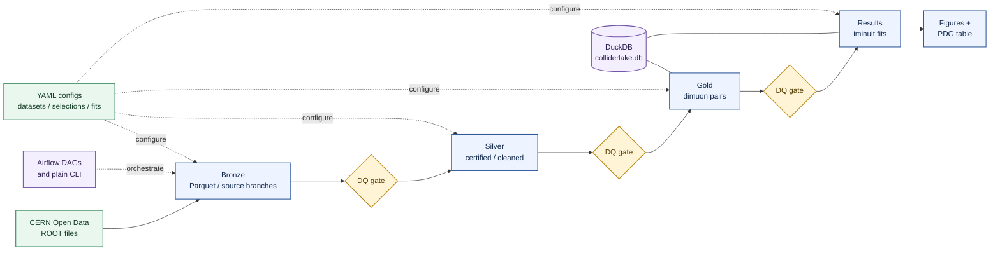

# ColliderLake

A lakehouse-style data platform for CMS Open Data. ColliderLake ingests real
collision data from the [CERN Open Data portal](https://opendata.cern.ch),
processes it through structured, quality-gated layers, and reproduces
benchmark particle-physics results with full provenance and reproducible,
scripted execution.

## Overview

Raw ROOT files land immutably with SHA-256 manifests. Bronze mirrors them as
Parquet. Silver applies detector certification (golden JSON) and object
cleaning while preserving trigger flags. Gold builds analysis objects —
opposite-charge dimuon pairs with invariant masses — under YAML-defined
selections whose hash is stamped on every row. A statistics layer fits each
resonance with iminuit (binned extended maximum likelihood) and compares the
results to Particle Data Group reference values. Every output number traces
back through a selection hash, a certification log, and a dataset DOI, and
data-quality gates between layers stop bad data from propagating.



## Goal

**Project RESONANCE:** reconstruct the dimuon resonance ladder — J/ψ, ψ′,
Υ(1S/2S/3S), and the Z boson — from 61.5M events of 2012 CMS DoubleMuParked
data, plus a golden-JSON-certified Z measurement from 2016 SingleMuon data.
Fitted masses compared against PDG values validate the pipeline: known
physics serves as ground truth. Deliverables: a preprint
(arXiv, `physics.data-an`), a Zenodo-archived release with DOI, and a
pipeline that reproduces all figures from a clean clone with a single
command.

A follow-up study (DIAMOND) is planned: model-agnostic anomaly detection on
the same gold tables, with signal-region blinding enforced at the storage
layer.

## Datasets

| Dataset | Record / DOI | Role |
|---|---|---|
| DoubleMuParked 2012 B+C (reduced NanoAOD, 61.5M events) | [12341](https://opendata.cern.ch/record/12341) · 10.7483/OPENDATA.CMS.YLIC.86ZZ | Full resonance ladder |
| SingleMuon Run2016H (UL NanoAODv9) | [30563](https://opendata.cern.ch/record/30563) | Certified Z measurement |
| Golden JSON 2016 | [14220](https://opendata.cern.ch/record/14220) | Luminosity certification |

## Quickstart

```bash
uv sync
uv run pytest                                                  # verify the physics core
python -m src.cli acquire --dataset run2012bc_doublemuparked   # chunked, resumable, checksummed
python -m src.cli run --dataset run2012bc_doublemuparked --stage all
```

Design documentation: `docs/ARCHITECTURE_2.0.md`.

## Status

Physics core built and verified (calibrated maximum-likelihood fits, exact
4-vector kinematics, per-dataset fit consolidation). Acquisition,
bronze/silver/gold layers, and DQ gates are operational. Airflow DAGs, CI,
figure generation, and the full-statistics production run are in progress.
The earlier proof-of-concept is preserved under `POC/`.
M1 resonance ladder result ledger: [docs/results/M1_RESONANCE_LADDER.md](docs/results/M1_RESONANCE_LADDER.md).

## License and disclaimer

CERN Open Data is released under CC0. This is an independent project:
*"Neither the experiment(s) (CMS) nor CERN endorse any works, scientific or
otherwise, produced using these data."*
